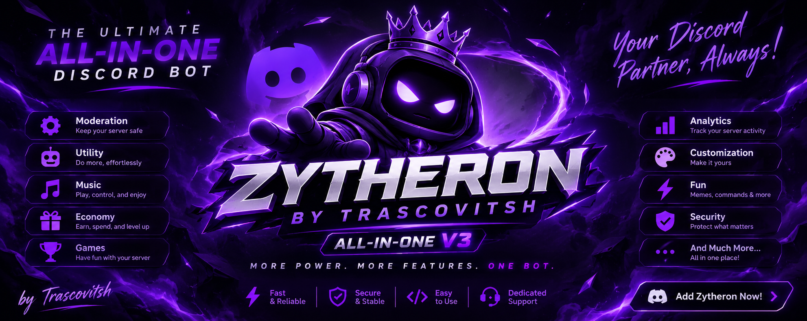
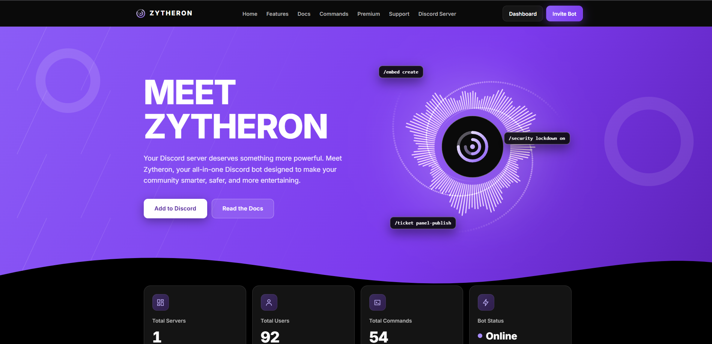
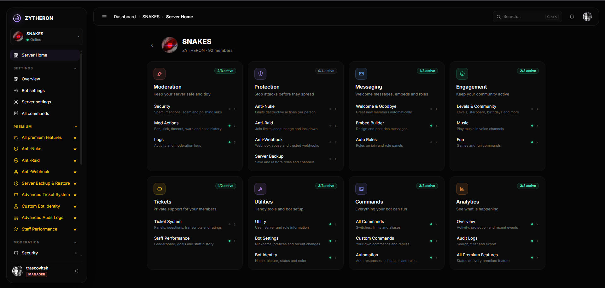
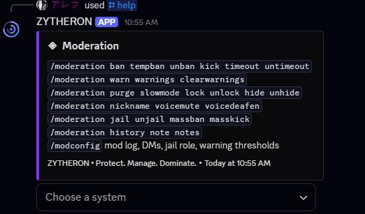
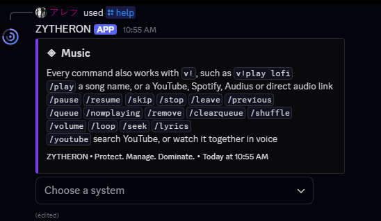
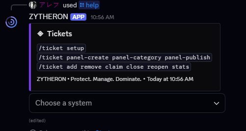

<h1 align="center">Zytheron</h1>

<p align="center">
  
</p>

<p align="center">
  <b>A self-hosted, all-in-one Discord bot for security, moderation, community and music, with a web dashboard.</b>
</p>

<p align="center">
  
  
  
  
</p>

Zytheron brings 54 slash commands (187 including subcommands) and a web dashboard together in one bot. It needs no database server, because data is saved as JSON files, and only one setting is required to start: your bot token.

## Contents

- [Features](#features)
- [Screenshots](#screenshots)
- [Quick start](#quick-start)
- [Configuration](#configuration)
- [Commands](#commands)
- [Development](#development)
- [Project status](#project-status)
- [License](#license)

## Features

| Area | What it does | Commands |
|---|---|---|
| **Security** | Action limits, raid detection, account age rules, whitelists, lockdown and automod filters | `/security`, `/automod` |
| **Moderation** | Bans, tempbans, kicks, timeouts, warnings, jail, purge, channel locks, notes and history | `/moderation`, `/modconfig` |
| **Logging** | Log categories that can each go to their own channel | `/logs` |
| **Welcome** | Welcome messages for new members | `/welcome` |
| **Roles** | Role panels, auto roles, temporary roles and self roles | `/rolepanel`, `/autorole`, `/temprole`, `/selfrole` |
| **Tickets** | Ticket panels with claim, close, reopen and stats | `/ticket` |
| **Automation** | Custom commands, auto responses, scheduled messages and rules | `/cc`, `/autoresponse`, `/schedule`, `/rule` |
| **Embeds** | Create, preview, edit and delete embeds, with a builder | `/embed` |
| **Levels** | XP, ranks, leaderboards and level rewards | `/level` |
| **Engagement** | Giveaways, polls, suggestions and a starboard | `/giveaway`, `/poll`, `/suggest`, `/suggestions`, `/starboard` |
| **Members** | Invite tracking, server stats, birthdays, AFK, challenges and profiles | `/invites`, `/serverstats`, `/birthday`, `/afk`, `/challenge`, `/profile` |
| **Music** | Playback, queue controls, lyrics and YouTube Watch Together | `/play`, `/queue`, `/lyrics`, `/youtube` and more |
| **Utility** | User and server info, avatars, dice rolls and more | `/user`, `/server`, `/avatar`, `/roles`, `/roll`, `/moveme` |
| **Dashboard** | Manage your server from a website after signing in with Discord | |
| **AI moderation** | Optional message classification, which needs an Anthropic API key | |

See the full list, with every option and required permission, in the [command checklist](docs/COMMAND_CHECKLIST.md).

## Screenshots

### Dashboard





### Moderation



### Music



### Tickets



## Quick start

You need [Node.js](https://nodejs.org) 20.11 or newer.

### 1. Create the bot

1. Open the [Discord Developer Portal](https://discord.com/developers/applications) and create an application.
2. On the **Bot** tab, click **Reset Token** and copy the token.
3. On the same tab, turn on **Server Members Intent** and **Message Content Intent**.

> [!WARNING]
> Your token gives full control of the bot. Never share or commit it. If it leaks, reset it straight away.

### 2. Install

Clone this repository (or download the ZIP) and open the folder in a terminal, then run:

```bash
npm install
```

### 3. Add your token

Copy the example settings to a new `.env` file:

```bash
# macOS / Linux
cp .env.example .env

# Windows (PowerShell)
Copy-Item .env.example .env
```

Then fill in `DISCORD_TOKEN` in `.env`.

### 4. Start the bot

```bash
npm start
```

This builds the project and starts the bot. If the bot isn't in any servers yet, the console prints an invite link.

After you add the bot, move its role above the roles and members it should manage, then run `/setup` to see what's still missing.

> [!NOTE]
> Zytheron won't overwrite slash commands registered by another bot on the same application. Use a new application, or see `REPLACE_COMMANDS` below.

## Configuration

Only `DISCORD_TOKEN` is required. [`.env.example`](.env.example) lists and explains every setting.

| Setting | What it does |
|---|---|
| `DISCORD_TOKEN` | Your bot token (required) |
| `DISCORD_CLIENT_SECRET` | Turns on the website |
| `DASHBOARD_URL`, `DASHBOARD_PORT` | Where the website runs (default `http://localhost:3000`) |
| `SUPPORT_URL` | Your Discord invite, for the homepage buttons |
| `YOUTUBE_API_KEY` | `/youtube` search and YouTube links in `/play` |
| `SPOTIFY_CLIENT_ID`, `SPOTIFY_CLIENT_SECRET` | Spotify links in `/play` (the app owner needs Premium) |
| `ANTHROPIC_API_KEY` | AI moderation |
| `DEV_GUILD_ID` | Registers commands instantly in one test server |
| `REPLACE_COMMANDS` | Set to `true` to replace another bot's commands on this application |
| `DATA_DIR` | Where data is saved (default `./data`) |

### Turning on the website

1. Copy the **Client Secret** from **OAuth2** in the Developer Portal into `DISCORD_CLIENT_SECRET`.
2. On that same page, add `<DASHBOARD_URL>/auth/callback` as a redirect.
3. If you run behind one reverse proxy, set `TRUST_PROXY=1`.

### Music

`/play` works with no accounts or API keys: search uses Audius and lyrics use LRCLIB.

### Your data

Settings and data are saved as JSON files in `data/`, which git ignores. To back up, copy that folder while the bot is stopped.

## Commands

Most setup starts with `/setup`, which shows what's missing. Some common commands:

| Command | What it does |
|---|---|
| `/help` | List commands |
| `/ping` | Check the bot's response time |
| `/setup` | Show what's still missing |
| `/moderation ban`, `kick`, `timeout`, `warn`, `purge` | Moderate members and messages |
| `/security setup` | Set up protection and its log channel |
| `/ticket setup` | Set up tickets |
| `/level rank` | Show a member's rank |
| `/giveaway create` | Start a giveaway |
| `/play` | Play music in your voice channel |

Many commands can also be typed with the `v!` prefix.

## Development

```bash
npm run dev                # run with reload on change
npm run typecheck          # check types
npm test                   # run the automated tests
npm run build              # compile to dist/
npm run dashboard:preview  # preview the dashboard with sample data
```

The 1,717 automated tests use a fake Discord, so they don't need a token or a connection.

```
src/
├── index.ts     # startup
├── config/      # settings and per-server configuration
├── core/        # commands, permissions, scheduling, shared code
├── dashboard/   # website API, sign-in and gateway
├── db/          # JSON file storage
├── modules/     # one folder per feature
└── ui/          # shared theme
public/          # website files
tests/           # automated tests
docs/            # command checklist
```

## Project status

Every command passes automated tests against a fake Discord, but a fake can't prove real Discord accepts every message or action. The [command checklist](docs/COMMAND_CHECKLIST.md) tracks which commands have also been confirmed on real Discord, and most haven't been ticked yet. Try moderation and security commands on a test server or an alt account first.

## License

[MIT](LICENSE) © 2026 Trascovitsh. Not affiliated with Discord.
